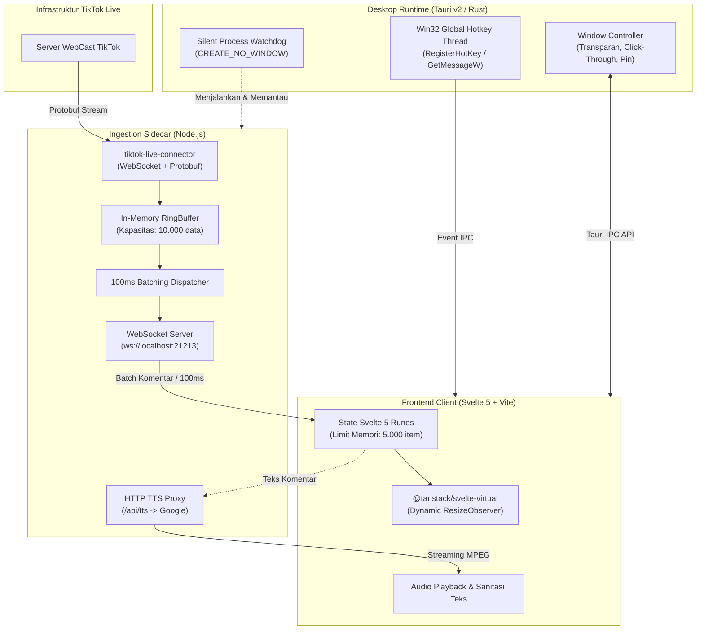
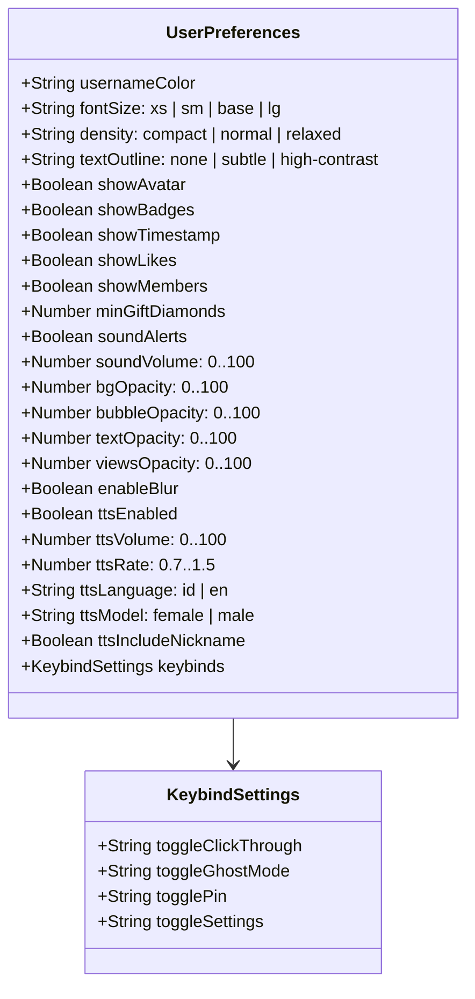

# TikTok-GhostChat

[](#kebutuhan-sistem)
[](https://v2.tauri.app/)
[](https://svelte.dev/)
[](https://nodejs.org/)
[](LICENSE)

*Baca dokumentasi ini dalam bahasa lain: [English](README.md).*

---

## Ringkasan Proyek

**TikTok-GhostChat** (nama kode *TikZient*) adalah aplikasi desktop overlay berkinerja tinggi dan ultra-ringan yang dirancang khusus untuk pembuat konten (*content creator*) dan streamer game. Aplikasi ini terhubung langsung ke webcast TikTok Live untuk menampilkan komentar, hadiah (*gift*), dan interaksi penonton secara *real-time* ke dalam antarmuka transparan (*Head-Up Display*) yang melayang di atas layar.

Berbeda dengan dock browser biasa atau aplikasi overlay berbasis Electron yang rakus memori, TikTok-GhostChat berjalan di atas **Tauri v2 (Rust)** yang dipadukan dengan **Node.js ingestion sidecar**. Hasilnya, aplikasi ini hanya mengonsumsi sekitar ~30 MB RAM, tidak menurunkan FPS game dalam mode full-screen, dan beroperasi penuh tanpa biaya langganan API pihak ketiga.

---

## Fitur Utama

- **Ghost Mode Sejati**: Menghilangkan seluruh bingkai jendela dan title bar, menyisakan deretan bubble chat transparan dan indikator penonton (*viewer count*). Area hover setinggi 4 piksel di tepi atas layar memungkinkan panel kontrol dipanggil kembali secara otomatis saat kursor mendekat.
- **Win32 Global Mouse Pass-Through**: Fitur tembus klik (*click-through*) yang memungkinkan kursor mouse menembus jendela chat langsung ke game atau aplikasi di bawahnya tanpa hambatan.
- **Global Hotkey Level OS**: Menggunakan thread Win32 native terpisah (`RegisterHotKey`) untuk membaca tombol pintas global. Streamer dapat mengunci atau membuka pass-through kursor langsung dari dalam game full-screen tanpa perlu Alt-Tab.
- **100% Bebas Biaya API**: Menggunakan pustaka `@zerodytrash/tiktok-live-connector` yang mengurai protokol WebCast TikTok melalui WebSocket dan Protobuf secara langsung.
- **Virtual DOM Scrolling Berperforma Tinggi**: Didukung oleh `@tanstack/svelte-virtual` untuk menjaga kestabilan 60+ FPS. Elemen DOM aktif dibatasi hanya 20–30 node berapapun kecepatan arus chat, dengan batas memori state frontend maksimal 5.000 item.
- **Layanan Google TTS Khusus Komentar**: Menggunakan reverse-proxy lokal untuk memutar audio Text-to-Speech langsung dari Google Translate TTS. Mendukung Bahasa Indonesia dan Inggris, model suara Wanita dan Pria, serta sanitasi teks cerdas (pembersihan spam tawa dan link).
- **Audio Chime Gift Prosedural**: Notifikasi suara dua nada harmonis (akor C6/E6) yang dihasilkan secara sintetis lewat Web Audio API tanpa membutuhkan file audio eksternal.
- **Kontrol Transparansi Presisi**: Slider independen 0%–100% untuk warna latar jendela, kartu chat, kontras tipografi, dan indikator penonton.
- **Mode Simulasi Demo**: Generator data bawaan untuk menguji tata letak, animasi gift, dan virtual scrolling tanpa harus menunggu siaran TikTok Live yang aktif.

---

## Arsitektur Sistem

Aplikasi ini mengimplementasikan **Pola Sidecar (Sidecar Pattern)** di mana proses scraping jaringan, manajemen jendela OS, dan rendering antarmuka berjalan pada thread terpisah agar UI tidak mengalami perlambatan (*freeze*) saat terjadi lonjakan trafik komentar.



---

## Tumpukan Teknologi

| Komponen | Pustaka / Teknologi | Keterangan |
| :--- | :--- | :--- |
| **Desktop Shell** | Tauri Core (Rust) | v2.x — Kontrol handle Win32, pintasan global, pengelolaan proses background tanpa jendela CMD |
| **Ingestion Engine** | Node.js Sidecar | Server WebSocket + HTTP lokal di port `localhost:21213` |
| **Konektor WebCast** | `tiktok-live-connector` | v2.5.0 — Protokol koneksi TikTok Live tanpa API berbayar |
| **Framework UI** | Svelte | v5.x (Arsitektur Runes modern: `$state`, `$derived`, `$effect`) |
| **Virtualizer** | `@tanstack/svelte-virtual` | Pengukuran ukuran elemen dinamis tanpa pemborosan node DOM |
| **Styling** | Tailwind CSS | v4.x — Utilitas desain dengan efek glassmorphism *backdrop-blur* |
| **Bundler & Bahasa** | Vite & TypeScript | v8.x / TypeScript 6.x |

---

## Kebutuhan Sistem

- **Sistem Operasi**: Windows 10 / Windows 11 (64-bit).
- **Dependensi Runtime**: Node.js v18.0.0 atau lebih baru terpasang pada komputer (diperlukan oleh engine sidecar).
- **Webview**: Microsoft Edge WebView2 Runtime (bawaan Windows 10/11).

---

## Panduan Instalasi & Penggunaan

### Opsi 1: Menjalankan File Executable Langsung
Aplikasi mandiri telah dikompilasi dan tersedia langsung di dalam repositori:
1. Pastikan Node.js telah terpasang di sistem Windows Anda (`node -v`).
2. Klik ganda file `tikzient.exe` atau `bin/tikzient.exe`.
3. Wrapper Rust akan secara otomatis mengeksekusi engine background secara *silent* di balik layar.

### Opsi 2: Menjalankan dari Source Code

#### Prasyarat
- [Node.js](https://nodejs.org/) (v18.0 atau lebih baru)
- [Rust & Cargo](https://rustup.rs/) (versi stabil terbaru)
- [Tauri CLI](https://v2.tauri.app/start/)

#### Langkah Pengembangan
1. Clone repositori:
   ```bash
   git clone https://github.com/anggixz/TikTok-GhostChat.git
   cd TikTok-GhostChat
   ```

2. Pasang dependensi utama dan frontend:
   ```bash
   npm install
   ```

3. Pasang dependensi sidecar:
   ```bash
   cd sidecar
   npm install
   cd ..
   ```

4. Jalankan server pengembangan (menjalankan Vite dan sidecar Node.js secara simultan):
   ```bash
   npm run dev
   ```

5. Jalankan aplikasi dalam shell desktop Tauri:
   ```bash
   npm run tauri:dev
   ```

#### Kompilasi Binary Rilis
Untuk mengompilasi binary rilis mandiri:
```bash
npm run tauri build
```
File executable hasil kompilasi akan berada di folder `src-tauri/target/release/`.

---

## Tombol Pintas Global (Hotkeys)

Seluruh tombol pintas berfungsi secara sistemik di seluruh sistem operasi, bahkan ketika game atau aplikasi lain sedang fokus secara penuh. Tombol dapat dikonfigurasi ulang pada tab **Keybinds** di menu pengaturan.

| Aksi | Pintasan Bawaan | Deskripsi |
| :--- | :--- | :--- |
| **Toggle Click-Through** | `Alt + G` | Mengunci atau membuka tembus klik mouse. Saat aktif, semua klik mouse langsung menembus overlay ke aplikasi di bawahnya. |
| **Toggle Ghost Mode** | `Alt + H` | Menyembunyikan atau menampilkan title bar dan tombol kontrol, menyisakan bubble chat dan indikator penonton. |
| **Toggle Always on Top** | `Alt + P` | Menyematkan jendela agar selalu berada di posisi paling atas layar. |
| **Toggle Settings Drawer** | `Alt + S` | Membuka atau menutup panel konfigurasi pengaturan streamer. |

---

## Preset Ukuran Jendela

Jendela overlay dapat diubah ukurannya secara bebas dari tepi batas jendela atau menggunakan preset instan dari menu header:

| Nama Preset | Dimensi | Rekomendasi Penggunaan |
| :--- | :--- | :--- |
| **Compact** | `280 x 420 px` | Monitor sekunder atau posisi samping layar game FPS |
| **Standard** | `380 x 600 px` | Tata letak umum untuk mayoritas live stream |
| **Wide** | `480 x 720 px` | Siaran dengan volume komentar tinggi dan teks panjang |

---

## Struktur Konfigurasi Pengguna

Konfigurasi pengguna disimpan secara persisten di penyimpanan lokal peramban (*localStorage*) dengan skema `tikzient_prefs_v3`.



---

## Struktur Direktori Proyek

```text
TikTok-GhostChat/
├── .vscode/               # Konfigurasi ekstensi editor kerja
├── bin/                   # Distribusi file executable mandiri hasil build
├── public/                # Aset ikon dan grafis statis
├── sidecar/               # Engine penangkap data berbasis Node.js
│   ├── engine.js          # Skrip penangkap data langsung via CLI
│   ├── package.json       # Dependensi sidecar (tiktok-live-connector, ws)
│   └── server.js          # Server HTTP & WebSocket sidecar produksi
├── src/                   # Antarmuka frontend (Svelte 5)
│   ├── assets/            # Aset visual dan branding
│   ├── lib/               # Modul utilitas dan klien data
│   │   ├── components/    # Komponen visual Svelte
│   │   │   ├── CommentItem.svelte         # Baris pesan komentar, gift, dan event gabung
│   │   │   ├── HeaderBar.svelte           # Title bar draggable dan tombol kontrol
│   │   │   ├── SettingsDrawer.svelte      # Panel laci pengaturan dan filter
│   │   │   └── VirtualCommentList.svelte  # Implementasi virtual scrolling TanStack
│   │   ├── preferences.ts        # Skema dan persistensi pengaturan pengguna
│   │   ├── sidecarClient.ts      # Klien WebSocket dan pemroses batch komentar
│   │   ├── soundAlert.ts         # Pembangkit audio sintesis Web Audio API
│   │   ├── tts.ts                # Layanan Google TTS dan pembersih teks spam
│   │   ├── types.ts              # Definisi tipe data TypeScript
│   │   └── windowController.ts   # Jembatan komunikasi IPC jendela Tauri
│   ├── app.css            # Stylesheet utama, scrollbar tersembunyi, dan kontras teks
│   ├── App.svelte         # Komponen induk tata letak dan orkestrator event
│   └── main.ts            # Entry point aplikasi Svelte 5
├── src-tauri/             # Backend desktop shell native berbasis Rust
│   ├── capabilities/      # Konfigurasi izin dan kapabilitas Tauri
│   ├── icons/             # Kumpulan ikon aplikasi berbagai resolusi
│   ├── src/
│   │   ├── lib.rs         # Thread Win32 hotkey, spawner sidecar, dan binding jendela
│   │   └── main.rs        # Titik masuk runtime aplikasi Rust
│   ├── Cargo.toml         # Konfigurasi crate Rust dan profil build
│   └── tauri.conf.json    # Konfigurasi jendela dan packaging Tauri
├── package.json           # Skrip npm dan dependensi paket frontend
├── tsconfig.json          # Konfigurasi compiler TypeScript
└── vite.config.ts         # Konfigurasi bundler Vite
```

---

## Batasan Tanggung Jawab & Merek Dagang

Proyek ini adalah perangkat lunak independen sumber terbuka (*open-source*) yang dikembangkan untuk tujuan edukasi dan utilitas pribadi. Proyek ini tidak berafiliasi dengan, disponsori oleh, atau memiliki hubungan resmi dengan TikTok, ByteDance Ltd., maupun anak perusahaannya.

Penggunaan aplikasi ini bergantung pada ketersediaan endpoint publik TikTok WebCast tanpa jaminan keandalan jangka panjang. Pengguna bertanggung jawab penuh atas kepatuhan terhadap aturan lokal serta syarat ketentuan layanan pihak ketiga terkait.

---

## Lisensi

Proyek ini didistribusikan di bawah naungan [GNU Affero General Public License v3.0 (AGPL-3.0)](LICENSE).
