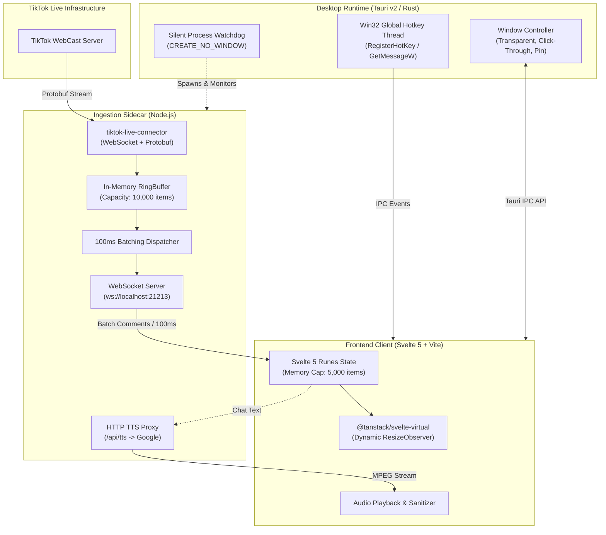
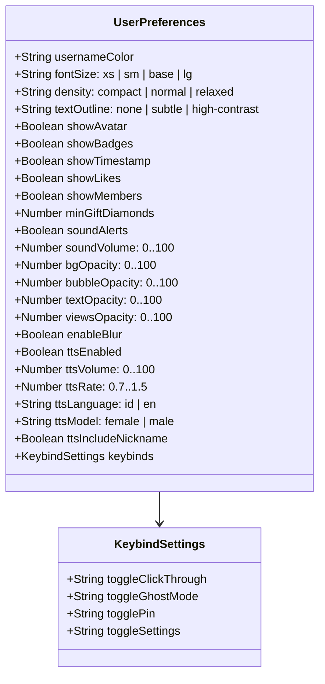

# TikTok-GhostChat

[](#system-requirements)
[](https://v2.tauri.app/)
[](https://svelte.dev/)
[](https://nodejs.org/)
[](LICENSE)

*Read this documentation in another language: [Bahasa Indonesia](README.id.md).*

---

## Overview

**TikTok-GhostChat** (codenamed *TikZient*) is a high-performance, ultra-lightweight desktop overlay engineered for content creators and live streamers. It connects directly to TikTok Live webcasts to deliver low-latency chat, gifts, and interaction feeds into a customizable, transparent, and non-intrusive desktop head-up display (HUD).

Unlike conventional web browser docks or heavyweight Electron-based overlays, TikTok-GhostChat operates on a native **Tauri v2 (Rust)** core paired with a headless **Node.js ingestion sidecar**. The resulting client occupies approximately ~30 MB of system RAM, generates no graphical overlay overhead during full-screen gameplay, and requires zero paid API subscriptions.

---

## Key Features

- **True Ghost Mode**: Strips window borders and standard title bar chrome entirely, leaving only a semi-transparent message stream and an optional minimalist viewer badge. A dedicated 4-pixel hover zone at the top screen edge automatically exposes the control bar on demand.
- **Win32 Global Mouse Pass-Through**: Enables absolute click-through capability into underlying games and applications. Users can interact with full-screen games without cursor obstruction.
- **OS-Level Global Hotkeys**: Utilizes dedicated Win32 message threads (`RegisterHotKey`) to register global shortcuts. Streamers can lock or unlock cursor pass-through instantly from inside any full-screen 3D game without alt-tabbing.
- **Zero Paid API Dependencies**: Powered by `@zerodytrash/tiktok-live-connector` reverse-engineering TikTok WebCast protocol streams over WebSocket and Protobuf.
- **Virtual DOM Scrolling**: Backed by `@tanstack/svelte-virtual` to maintain consistent 60+ FPS rendering performance. The active DOM footprint is limited to 20–30 nodes regardless of chat volume, with an in-memory client buffer capped at 5,000 items.
- **Dedicated Google TTS Service**: Local streaming reverse-proxy routing comment audio through Google Translate TTS endpoints. Includes Indonesian and English language sets, masculine and feminine acoustic modeling, and smart spam filtering.
- **Procedural Audio Alerts**: Dual-tone synthesized audio alerts (C6/E6 chords) generated via the native Web Audio API upon gift receipt, eliminating bundled audio asset overhead.
- **Granular Transparency Controls**: Independent 0%–100% opacity sliders for the main window background, chat cards, typography contrast, and viewer count telemetry.
- **Built-In Simulation Mode**: Interactive mock engine allowing instant testing of layout scaling, gift counters, and virtualized scrolling without an active TikTok webcast.

---

## Architecture

The project implements a decoupled **Sidecar Architecture** where network ingestion, system-level window management, and user interface rendering run in discrete threads to prevent interface blocking during burst traffic.



---

## Technology Stack

| Layer | Component | Version / Description |
| :--- | :--- | :--- |
| **Desktop Shell** | Tauri Core (Rust) | v2.x — Native Win32 window handles, global shortcuts, silent sidecar process management |
| **Ingestion Engine** | Node.js Sidecar | Local WebSocket + HTTP server on `localhost:21213` |
| **WebCast Scraper** | `tiktok-live-connector` | v2.5.0 — Free WebSocket WebCast ingestion |
| **Frontend Framework** | Svelte | v5.x (Modern Runes: `$state`, `$derived`, `$effect`) |
| **Virtualizer** | `@tanstack/svelte-virtual` | Dynamic element measuring with zero DOM degradation |
| **Styling** | Tailwind CSS | v4.x — Utility-first styling with hardware-accelerated backdrop blur |
| **Tooling & Bundler** | Vite & TypeScript | v8.x / TypeScript 6.x |

---

## System Requirements

- **Operating System**: Windows 10 / Windows 11 (64-bit).
- **Runtime Dependency**: Node.js v18.0.0 or higher installed on the host machine (required for the ingestion sidecar engine).
- **Webview Environment**: Microsoft Edge WebView2 Runtime (pre-installed on Windows 10/11).

---

## Installation & Setup

### Option 1: Standalone Binary Execution
Pre-compiled executable binaries are available directly in the project structure:
1. Ensure Node.js is installed on your Windows system (`node -v`).
2. Run `tikzient.exe` or `bin/tikzient.exe`.
3. The native Rust wrapper will automatically launch the background sidecar process silently.

### Option 2: Running from Source

#### Prerequisites
- [Node.js](https://nodejs.org/) (v18.0 or higher)
- [Rust & Cargo](https://rustup.rs/) (latest stable release)
- [Tauri CLI](https://v2.tauri.app/start/)

#### Development Environment
1. Clone the repository:
   ```bash
   git clone https://github.com/anggixz/TikTok-GhostChat.git
   cd TikTok-GhostChat
   ```

2. Install root and frontend dependencies:
   ```bash
   npm install
   ```

3. Install sidecar dependencies:
   ```bash
   cd sidecar
   npm install
   cd ..
   ```

4. Start development server (simultaneously launches Vite frontend and Node.js sidecar):
   ```bash
   npm run dev
   ```

5. Run within the native Tauri desktop shell:
   ```bash
   npm run tauri:dev
   ```

#### Production Build
To compile the standalone portable binary:
```bash
npm run tauri build
```
Compiled binaries will be generated inside `src-tauri/target/release/`.

---

## Default Global Shortcuts

All shortcuts function system-wide, even when another application or game holds exclusive focus. Shortcuts can be customized in the **Keybinds** settings tab.

| Action | Default Shortcut | Description |
| :--- | :--- | :--- |
| **Toggle Click-Through** | `Alt + G` | Locks/unlocks mouse pass-through. When active, all mouse clicks bypass the overlay into the background application. |
| **Toggle Ghost Mode** | `Alt + H` | Toggles window header and control borders, showing only chat cards and the floating viewer badge. |
| **Toggle Always on Top** | `Alt + P` | Pins or unpins the overlay above all other open windows and games. |
| **Toggle Settings Drawer** | `Alt + S` | Opens or closes the streamer configuration panel. |

---

## Window Size Presets

The overlay window can be manually resized from any border or adjusted via preset dimensions in the header menu:

| Preset Name | Dimensions | Optimal Use Case |
| :--- | :--- | :--- |
| **Compact** | `280 x 420 px` | Second-monitor sidebars or dense FPS HUD positions |
| **Standard** | `380 x 600 px` | Standard streaming overlay layout |
| **Wide** | `480 x 720 px` | High-traffic streams with long chat messages |

---

## Configuration & Preferences

Preferences are persistently stored in the browser's local storage schema (`tikzient_prefs_v3`).



---

## Project Structure

```text
TikTok-GhostChat/
├── .vscode/               # Recommended workspace extensions
├── bin/                   # Pre-compiled standalone executable distribution
├── public/                # Static vector assets and icons
├── sidecar/               # Headless Node.js ingestion engine
│   ├── engine.js          # Direct CLI ingestion script
│   ├── package.json       # Sidecar dependencies (tiktok-live-connector, ws)
│   └── server.js          # Production HTTP & WebSocket sidecar server
├── src/                   # Frontend user interface (Svelte 5)
│   ├── assets/            # Interface graphics and branding
│   ├── lib/               # Shared client modules and utility services
│   │   ├── components/    # Svelte interface components
│   │   │   ├── CommentItem.svelte         # Individual message, gift, and join row
│   │   │   ├── HeaderBar.svelte           # Draggable title bar and control buttons
│   │   │   ├── SettingsDrawer.svelte      # Configuration drawers and tabs
│   │   │   └── VirtualCommentList.svelte  # TanStack virtualized list implementation
│   │   ├── preferences.ts        # Persistent state and default schema
│   │   ├── sidecarClient.ts      # WebSocket client and throttling consumer
│   │   ├── soundAlert.ts         # Procedural Web Audio API synthesizer
│   │   ├── tts.ts                # Google Text-to-Speech service and text sanitizer
│   │   ├── types.ts              # Core TypeScript interface definitions
│   │   └── windowController.ts   # Tauri native window IPC bridge
│   ├── app.css            # Base stylesheet, custom scrollbars, and text outlines
│   ├── App.svelte         # Root application layout and event orchestrator
│   └── main.ts            # Svelte 5 application entry point
├── src-tauri/             # Rust desktop shell backend
│   ├── capabilities/      # Tauri permission configurations
│   ├── icons/             # Multi-resolution application icons
│   ├── src/
│   │   ├── lib.rs         # Win32 hotkey thread, sidecar spawner, window bindings
│   │   └── main.rs        # Application runtime entry point
│   ├── Cargo.toml         # Rust crate dependencies and build profiles
│   └── tauri.conf.json    # Tauri window and bundler configuration
├── package.json           # Root package scripts and frontend dependencies
├── tsconfig.json          # TypeScript compiler configuration
└── vite.config.ts         # Vite bundler configuration
```

---

## Legal & Disclaimer

This project is an independent open-source tool developed for educational and personal utility. It is not affiliated with, endorsed by, or in any way officially connected with TikTok, ByteDance Ltd., or any of their subsidiaries. 

The software utilizes public webcast reverse-engineered endpoints without warranty of any kind. Users are solely responsible for compliance with local regulations and third-party terms of service.

---

## License

This project is licensed under the [GNU Affero General Public License v3.0 (AGPL-3.0)](LICENSE).
